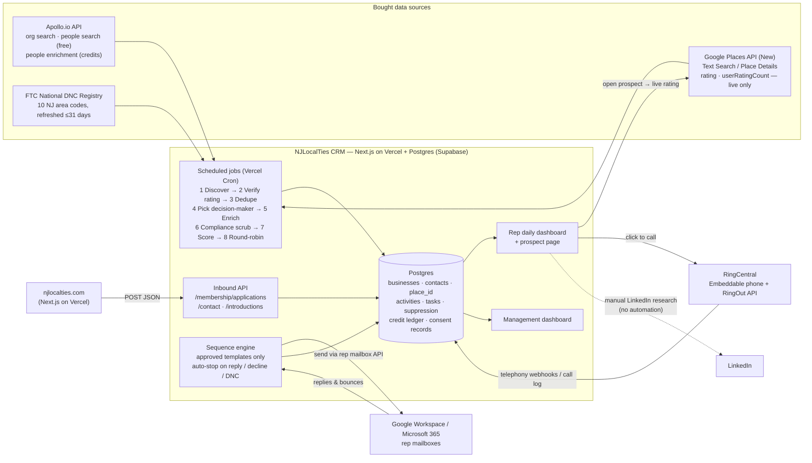

# NJLocalTies CRM & Prospecting Engine — Phase 0 Proposal

**Prepared for:** Chris, NJLocalTies
**Date:** November 5, 2026
**Status:** Proposal only. No code has been written. Nothing in Phase 1 starts until you approve this document and answer the open questions in section 10.

> All prices, limits and terms below were read from the vendors' own pages on **2026-11-05** and are linked. Anything marked **(not confirmed)** could not be verified from a primary source and must be confirmed with the vendor before we rely on it. Nothing here is legal advice; items marked **⚖ Legal sign-off** need a lawyer.

---

## 1. Executive summary

**What you asked for is buildable, with three important changes.**

1. **Google's terms do not let us store Google ratings and review counts.** Google Maps Platform allows only the `place_id` to be stored long-term. Rating, review count, name, phone, address and website may not be cached or saved, and building a stored listing database from Places data is expressly prohibited. **Change:** the CRM stores Google's `place_id` and a "verified ≥ 4.5 on *date*" result; the rating and review count are fetched **live** from Google every time a rep opens the prospect, shown with "Google Maps" attribution. Business contact data itself comes from Apollo (whose terms *do* allow storing it in our CRM). ⚖ Legal sign-off recommended (section 7.1).

2. **New Jersey law bars unsolicited telemarketing sales calls to a person's mobile phone — whether or not the number is on a Do-Not-Call list** (N.J.A.C. 13:45D-4.1(a)(3); N.J.S.A. 56:8-130). Mobile numbers are also the most expensive thing Apollo sells (+8 credits each). **Change:** until a lawyer confirms otherwise, the system will **not** buy or dial cold mobile numbers. It will use direct business lines and main lines, and allow mobile calls only for people who gave written consent (e.g. an inbound website lead who ticks a consent box). ⚖ Legal sign-off required.

3. **50–100 new prospects per rep per day is more than one rep can work.** Your 6-touch, 14-day sequence means each new prospect generates 3 calls, 3 emails and a LinkedIn task. At 50 new/day, a rep would face ~150 calls/day from the sequence alone after week two. **Recommendation:** start at **20–30 new prospects per rep per day** and tune from pilot data. The system can produce more; the constraint is rep time and data supply.

**Recommended approach: (c) Hybrid — a lightweight custom CRM (Next.js + Postgres on Vercel, same stack as the website) that *buys* every hard part:** Apollo for contact data, Google Places for live rating verification, RingCentral for calling (its free API and open-source embeddable phone), your existing Google Workspace / Microsoft 365 mailboxes for sequence email, and the FTC Do-Not-Call registry for scrubbing. No Make.com: scheduled jobs run inside the app. Reasons in section 2.

**Estimated cost:**

| | Pilot (2 reps) | Full (5–10 reps) |
|---|---|---|
| Monthly software & API | **≈ $140 – $250 / mo** | **≈ $530 – $1,450 / mo** |
| Development effort | **≈ 210 – 330 hours** (Phase 1) | **+ ≈ 80 – 140 hours** (Phase 2) |
| Calendar time | **6–9 weeks build + 4–6 weeks pilot** | **+ 3–4 weeks** |

RingCentral seats and email mailboxes are excluded (you already pay for them). Details in sections 4–6.

---

## 2. Recommended architecture and build-vs-buy

### 2.1 The options

| | (a) Off-the-shelf CRM + automation | (b) Fully custom | (c) **Hybrid (recommended)** |
|---|---|---|---|
| What it is | HubSpot / Pipedrive / Close, plus Make/n8n/Zapier, plus Apollo | Build everything, incl. our own data sources/dialer | Custom thin CRM + bought data, calling and email services |
| Google live-rating rule | **Poor fit** — every one of these CRMs stores fields; putting rating/review count in a CRM field is exactly what Google prohibits. Would still need custom code to show live ratings. | Fits | **Fits** — live fetch on open |
| Compliance gates (DNC scrub, NJ mobile rule, call windows, suppression *before* dialing) | Partly — needs custom glue; built-in dialers don't know our NJ rules | Fits | **Fits** — the dial button is only enabled when every check passes |
| RingCentral | HubSpot ✔ (official app, auto-logs calls) · Pipedrive ✔ (RingCentral App Connect) · **Close ✘** (uses its own telephony) · **Apollo dialer ✘** (Apollo numbers only) | Fits | **Fits** — RingCentral Embeddable + RingOut + call-log webhooks |
| Round-robin | HubSpot: **Professional tier only** | Fits | Fits |
| Cost (pilot) | HubSpot Sales Pro ≈ $90–$100/seat/mo + **$1,500 onboarding**, plus Apollo, Google and automation | Lowest subscriptions, highest dev | **≈ $140–$250/mo all-in** |
| Time to pilot | Fastest *for CRM basics*, but Google/compliance work is custom either way | Slowest | Medium |
| Maintenance by a small team | Low for CRM, medium for glue (Make scenarios break silently) | High | **Medium** — one codebase, all managed services, no servers |

**Why not (a):** the two hardest requirements — Google's no-storage rule and the pre-dial compliance checks — are custom work in every off-the-shelf CRM, so you'd pay CRM seat fees *and* still fund custom development. HubSpot, the strongest (a) candidate for RingCentral, needs the Professional tier for round-robin rotation ([HubSpot KB](https://knowledge.hubspot.com/workflows/assign-and-rotate-record-owners-using-workflows)), at roughly $90–$100 per seat per month plus a $1,500 onboarding fee ([HubSpot pricing](https://www.hubspot.com/pricing/sales)).

**Why not (b):** building our own contact database or dialer gives no advantage; Apollo and RingCentral already do this.

**Why (c):** the custom part is the part only NJLocalTies needs — the qualification rules, compliance gates, sequence rules and dashboards. Everything else is rented. It matches the website's stack (Next.js on Vercel), so one developer can maintain both, and the CRM can serve the website's form endpoints directly.

**Why no Make.com:** the pipeline is a handful of scheduled jobs (discover → verify → enrich → scrub → assign → sequence). Vercel Pro runs up to 100 cron jobs per project as often as once a minute ([Vercel cron limits](https://vercel.com/docs/cron-jobs/usage-and-pricing)), and functions can run up to 800 seconds ([Vercel function limits](https://vercel.com/docs/functions/limitations)). Keeping the logic in code means it is version-controlled, testable and can't drift from the CRM. If longer workflows are needed, Inngest's free tier (50,000 executions/month, [pricing](https://www.inngest.com/pricing)) is a drop-in.

### 2.2 Architecture diagram

### 2.3 How the pipeline works

Because Google content can't be stored or exported to another service, we **flip Chris's proposed order**: Apollo finds the businesses, Google verifies them live.

| Step | What happens | Source | Cost |
|---|---|---|---|
| 1. Discover | Apollo organization search: NJ location + industry keywords (law, medical practice, real estate, CPA, contractor…) + size. Stored in our DB (Apollo permits this). | [Apollo API](https://docs.apollo.io/docs/api-pricing) | 1 credit per search page |
| 2. Verify rating | Google Text Search for "business name, town, NJ", requesting only `id`, `rating`, `userRatingCount`. If matched and rating ≥ 4.5 with ≥ N reviews, store **only** `place_id` + "qualified on *date*". Rating itself is discarded. | [Places Text Search](https://developers.google.com/maps/documentation/places/web-service/text-search) | $35 / 1,000 after 1,000 free/month |
| 3. Dedupe | Match on `place_id`, Apollo org ID, website domain, normalized phone and normalized name+address. Contacts on Apollo person ID, email and LinkedIn URL. Website leads checked against the same keys. | — | — |
| 4. Pick decision-maker | Apollo people search at that org (owner, founder, president, CEO, managing partner, principal…), ranked by title. | [Apollo people search](https://docs.apollo.io/reference/people-api-search) | **0 credits** |
| 5. Enrich | Apollo people enrichment for the chosen 1 (optionally 2) people only: work email, direct dial, LinkedIn URL. Mobile only if legal clears it. Every credit spent is logged to a credit ledger. | [Apollo enrichment](https://docs.apollo.io/reference/people-enrichment) | 1 credit (email); +8 if a mobile is returned |
| 6. Compliance scrub | Internal DNC list, national DNC registry (≤ 31 days old), line type (Apollo returns `mobile` / `work_direct`), NJ mobile rule, email suppression list, existing members/customers. | section 7.2 | DNC: $425/yr |
| 7. Score & flag | Score on: rating margin, review volume, decision-maker found, direct dial found, verified email, LinkedIn found, industry fit. Flag missing/questionable data (unverified email, main-line-only, title mismatch). | — | — |
| 8. Assign | Only qualified prospects enter the pipeline. Even round-robin across active reps, with ownership + assignment timestamp; manager can reassign. | — | — |

When a rep opens a prospect, the CRM calls Google Place Details by `place_id` and shows the **current** rating and review count with "Google Maps" attribution ([Places policies](https://developers.google.com/maps/documentation/places/web-service/policies)). That call costs $20 per 1,000 after 1,000 free/month ([pricing](https://developers.google.com/maps/billing-and-pricing/pricing)).

---

## 3. Feasibility of the integrations

| Integration | Feasible? | How | Caveats |
|---|---|---|---|
| **Apollo ↔ CRM** | **Yes** | REST API. Search, people search (free) and enrichment (credits) are available on paid plans ([Apollo API overview](https://docs.apollo.io/reference/apollo-api)). Mobile numbers are delivered **asynchronously to a webhook** we host ([docs](https://docs.apollo.io/docs/retrieve-mobile-phone-numbers-for-contacts)). Bulk enrichment takes 10 people per call ([docs](https://docs.apollo.io/reference/bulk-people-enrichment)). Rate limits on paid plans: enrichment 1,000/min; search 200/min, 6,000/hr, 50,000/day ([rate limits](https://docs.apollo.io/reference/rate-limits)). | Apollo's pricing FAQ says "API access is available on Custom plans" while its plan comparison and API docs say most endpoints work on all plans — **confirm with Apollo before buying**. Apollo's terms allow keeping data synced into our CRM, even after cancelling, for internal use; they forbid resale/disclosure to third parties and using the API "with LinkedIn automations" ([Apollo terms](https://www.apollo.io/terms)). |
| **Apollo ↔ Google Places** | **Yes, with the order flipped** | Apollo provides business name/town; Google verifies rating live (section 2.3). | Sending Google data *into* Apollo (Google-first discovery, then looking up the website in Apollo) is arguably "export… for use outside the Services," which Google prohibits ([Google Maps Platform ToS §3.2.3](https://cloud.google.com/maps-platform/terms)). The Apollo-first design avoids this. ⚖ |
| **Google Places ↔ CRM** | **Yes, live-only** | Store `place_id` permanently (expressly allowed: "You can therefore store place ID values indefinitely" — [policies](https://developers.google.com/maps/documentation/places/web-service/policies)). Fetch rating/review count on demand. | No storing rating, review count, reviews, phone, address or website ([Service Specific Terms](https://cloud.google.com/maps-platform/terms/maps-service-terms); [ToS §3.2.3](https://cloud.google.com/maps-platform/terms)). Text Search returns max 60 results per query ([docs](https://developers.google.com/maps/documentation/places/web-service/text-search)). The Business Profile reviews API only works for verified locations you own or manage, so it cannot be used for prospects ([GBP policies](https://developers.google.com/my-business/content/policies)). |
| **RingCentral ↔ CRM** | **Yes** | **RingCentral Embeddable** — an open-source softphone dropped into the CRM page with click-to-dial and call-logging events ([Embeddable](https://ringcentral.github.io/ringcentral-embeddable/)). Alternatively the **RingOut API** rings the rep's phone, then the prospect ([RingOut](https://developers.ringcentral.com/guide/voice/ringout)). Calls log back via telephony-session webhooks and the Call Log API ([call log](https://developers.ringcentral.com/guide/voice/call-log)). | API access is included with RingEX plans (per RingCentral community answers — confirm for your account). App "graduation" review was retired in 2024; new apps get production credentials ([announcement](https://community.ringcentral.com/developer-platform-apis-integrations-5/announcement-developing-for-ringcentral-just-got-a-lot-easier-9262)). Call log is "Heavy" rate group: 10 requests/min per user ([rate limits](https://developers.ringcentral.com/guide/basics/rate-limits)), so we use webhooks rather than polling. |
| **Website ↔ CRM** | **Yes** | The site already calls `apiPost()` against `NEXT_PUBLIC_API_URL` (`src/lib/api/endpoints.ts`). The CRM will implement `POST /membership/applications`, `/contact`, `/introductions` with the same JSON bodies and the error shape the site expects (`{message, fieldErrors}`). Each becomes a lead tagged `source = website:application / contact / introduction`. | The site sends `credentials: "include"`, so the CRM must return CORS headers for the exact site origin. The auth endpoints (`/auth/*`, `/members/me/profile`) are member-account features, **not** CRM features — out of scope here. We'll propose a small site change: a legal-approved consent checkbox on forms that collect phone numbers. |
| **Email sequences** | **Yes** | Send from each rep's own Google Workspace or Microsoft 365 mailbox via their API, from approved templates only. Replies land in the same mailbox, so the CRM can detect them and stop the sequence. | Transactional senders like Postmark forbid unsolicited mail in their terms ([Postmark ToS](https://postmarkapp.com/terms-of-service)) — not suitable for cold sequences. Apollo's own sequences are an alternative (Basic: 250 emails/day/mailbox) but would split activity history across two systems. |
| **LinkedIn** | **Manual only (as you specified)** | Apollo supplies the LinkedIn URL when it has one; the Day-5 task links the rep to it. | No LinkedIn automation of any kind. Apollo's terms also forbid using its API with LinkedIn automations. |

---

## 4. Development cost and effort

Estimates are **hours of development work**, because cost depends on who builds it. Multiply by your developer's rate. *Illustration only: at $100/hr Phase 1 would be ≈ $21k–$33k; at $150/hr ≈ $31.5k–$49.5k. These are not quotes.*

### Phase 1 — Pilot build (recommended option c)

| Work item | Hours |
|---|---|
| Project setup, database schema, rep/manager login, roles | 16 – 24 |
| Website inbound endpoints (+ CORS, validation, source tagging) and the consent-checkbox change on the site | 12 – 20 |
| Discovery (Apollo org search) and Google live verification, `place_id` storage | 24 – 40 |
| Decision-maker selection, Apollo enrichment, mobile webhook, credit ledger | 16 – 24 |
| Compliance: DNC registry import & 31-day refresh, internal DNC list, NJ mobile rule, calling window, email suppression, consent records | 20 – 32 |
| Rep daily dashboard + prospect page (live rating, contact data, history, next follow-up, opening points) | 32 – 48 |
| RingCentral Embeddable click-to-call, call logging via webhooks, disposition capture | 20 – 32 |
| Sequence engine: approved templates, rep-mailbox sending, unsubscribe (link + one-click header), reply/bounce detection, auto-stop | 32 – 48 |
| Round-robin assignment, reassignment, follow-up reminders, pipeline statuses, dedupe UI | 12 – 20 |
| Testing with test records/inboxes, deployment, rep training notes | 16 – 24 |
| Pilot measurement (accuracy-check dispositions, pilot report) | 8 – 16 |
| **Total** | **≈ 210 – 330** |

### Phase 2 — After the pilot

Full sequence automation tuning, management dashboard (all section-7 metrics including cost per qualified lead and per acquisition), whole-team rollout, volume scaling, any pilot fixes: **≈ 80 – 140 hours**.

### For comparison — option (a) HubSpot Professional + automation

CRM configuration is faster, but the Google live-rating panel, compliance gates and Apollo credit control would still be custom code (a HubSpot app/CRM card plus integration service). Rough estimate **≈ 120 – 200 hours** for Phase 1, plus HubSpot seat fees every month and the $1,500 onboarding fee. The development saving does not offset the ongoing cost difference within the first year at 5–10 seats.

---

## 5. Monthly software and API costs

**Volume assumptions.**
- *Pilot:* 2 reps, 150–200 qualified businesses over the pilot, ≈ 1,000–2,000 candidates checked against Google.
- *Full:* 5–10 reps × 25 new prospects/day × 22 working days = **2,750–5,500 new prospects/month**, ≈ 3× that many candidates checked; each rep opens ≈ 60 prospect pages/day.

### 5.1 Recommended stack (option c)

| Item | Pilot / month | Full / month | Source & notes |
|---|---|---|---|
| **Apollo.io** | **$49 – $99** (1 seat) | **$79 – $474** | Annual billing: Basic $49, Professional $79, Organization $119 (3-seat minimum) per user/month; annual credits Basic 30,000, Professional 48,000, Organization 72,000 ([Apollo](https://www.apollo.io/insights/more-information-on-what-they-are-paying-for-in-apollo-plan-detailsusage-walkthrough), [pricing](https://www.apollo.io/pricing)). Monthly-billing prices **not confirmed** (page data shows Professional $99/mo). Credits: 1 per email, +8 per mobile returned, 1 per org search page ([API pricing](https://docs.apollo.io/docs/api-pricing)). **Pilot:** ≈ 300–1,000 credits — one Basic seat covers it. **Full, no mobiles:** ≈ 3k–6k credits/mo → 1 Professional to 1 Organization plan. **Full, with mobiles (if legal clears):** ≈ 12k–24k credits/mo → ≈ 3–6 Professional seats. Whether credits are per seat or pooled per team and the add-on credit price are **not confirmed** — get an Apollo quote. |
| **Google Places API** | **$0 – $60** | **≈ $360 – $800** | Text Search Enterprise $35/1,000 (1,000 free/mo); Place Details Enterprise $20/1,000 (1,000 free/mo). Rating and review count are Enterprise-tier fields ([pricing](https://developers.google.com/maps/billing-and-pricing/pricing), [fields](https://developers.google.com/maps/documentation/places/web-service/data-fields)). Full = 8k–17k verifications + 6.6k–13.2k live opens. |
| **Vercel Pro** | $20 | $20 – $40 | $20 per developer seat/month incl. $20 usage credit ([Vercel](https://vercel.com/pricing)). |
| **Supabase Pro** (Postgres + login) | $25 | $25 – $60 | From $25/month, 8 GB disk included ([Supabase](https://supabase.com/pricing)). Upper end allows for usage overage — estimate. |
| **National DNC Registry** | ≈ $35 | ≈ $35 | First 5 area codes free, $85 per extra area code/year (FY2027). NJ's 10 area codes = **$425/year** ([FTC fees](https://www.ftc.gov/news-events/news/press-releases/2026/08/ftc-announces-2027-telemarketer-fees-access-national-do-not-call-registry)). |
| **NJ telemarketer registration** (if required ⚖) | ≈ $13 | ≈ $13 – $42 | $150/yr for 1–5 simultaneous callers, $500/yr for 6–15 ([N.J.A.C. 13:45D-1.4](https://www.law.cornell.edu/regulations/new-jersey/N-J-A-C-13-45D-1-4)). |
| **Background jobs** (Inngest, only if needed) | $0 | $0 | Free tier 50,000 executions/mo ([Inngest](https://www.inngest.com/pricing)). |
| RingCentral | $0 extra | $0 extra | Existing RingEX seats ($20–$35/user/mo annual; [RingCentral](https://www.ringcentral.com/office/plansandpricing.html)). API use included. |
| Email sending | $0 extra | $0 extra | Existing Google Workspace / Microsoft 365 rep mailboxes (to confirm — Q4). |
| **Total** | **≈ $140 – $250** | **≈ $530 – $1,450** | |

### 5.2 Option (a) for comparison (adds to Apollo + Google + DNC above)

| Item | Pilot | Full | Source |
|---|---|---|---|
| HubSpot Sales Hub Professional (reps + 1 manager) | ≈ $270 – $300 + $1,500 once | ≈ $540 – $1,100 | $90 / $100 per seat/month — the page doesn't clearly label which is annual vs monthly ([HubSpot](https://www.hubspot.com/pricing/sales)) |
| Make.com | ≈ $9 – $38 | ≈ $16 – $38+ | **Not confirmed** — pricing page didn't render; figures from search snippets and Make's blog ([Make](https://www.make.com/en/pricing)) |
| Hosting for custom glue | ≈ $20 – $45 | ≈ $20 – $60 | as above |

Pipedrive (RingCentral via App Connect) is an alternative (a); its pricing page blocked automated reading, so its prices are **not confirmed**. Close was excluded because it has no RingCentral integration ([Close pricing](https://www.close.com/pricing) shows its own built-in calling).

---

## 6. Development timeline

| Week | Work | Depends on |
|---|---|---|
| 0 – 1 | Kick-off; you provide accounts & credentials (section 9); **send legal questions to counsel** (section 7.3); register for the DNC SAN | Your approval |
| 1 – 3 | Schema, logins, website endpoints, discovery + Google verification, Apollo enrichment on test records | Apollo + Google keys |
| 3 – 5 | Compliance layer, rep dashboard, prospect page, round-robin | DNC SAN |
| 5 – 7 | RingCentral click-to-call and logging, sequence engine against **test inboxes only** | RingCentral app, mailbox OAuth |
| 7 – 9 | QA, dry run with fake data, rep training; **go-live gate:** legal sign-off received, templates approved | Counsel's answers |
| 9 – 15 | **Pilot live:** 2 reps, 100–200 qualified businesses, at least 2 full 14-day sequence cycles | — |
| 15 – 16 | Pilot report (accuracy, conversations, conversion, cost per lead) | — |
| 16 – 20 | Phase 2: management dashboard, sequence tuning, team rollout | Pilot review |

The legal review runs in parallel and is the most likely cause of delay. **No real calls or emails go out until it's done.**

---

## 7. Limitations and risks

### 7.1 API access and licensing

- **Google Maps Platform:** only `place_id` may be stored indefinitely; lat/lng for up to 30 days; nothing else ([Service Specific Terms](https://cloud.google.com/maps-platform/terms/maps-service-terms)). The ToS prohibits pre-fetching, storing or bulk-downloading places info, "copy and save business names, addresses, or user reviews", "create content based on Google Maps Content", and using Core Services "in a listings or directory service" ([ToS §3.2.3](https://cloud.google.com/maps-platform/terms)). Our design keeps Google data live-only and sources stored data from Apollo, but storing a "qualified ≥ 4.5 on date" flag is a grey area. ⚖
- **Google review text** is not used at all: it's the most expensive tier (Enterprise + Atmosphere), and reviews must show author credit. "Positive reviews" will be judged by rating ≥ 4.5 plus a minimum review count (Q6).
- **Yelp and scrapers are not alternatives.** Yelp's API terms prohibit storing content beyond 24 hours or building "your own database of business listing information" ([Yelp API terms](https://terms.yelp.com/developers/api_terms/)). Google-scraping services (Outscraper, SerpAPI, etc.) violate Google's "No Scraping" clause.
- **Apollo:** no accuracy warranty ("APOLLO DOES NOT REPRESENT OR WARRANT THE ACCURACY… OF ANY DATA"); no resale or disclosure to third parties — so Apollo-sourced prospect data must **never be shown to NJLocalTies members** (e.g. in the member directory) ([Apollo terms](https://www.apollo.io/terms)). ⚖
- **RingCentral:** Embeddable lets reps type any number. The CRM controls the click-to-call button, but a rep could still dial manually. This is covered by training and by audits of the call log against the suppression list.

### 7.2 Compliance — controls built into the pipeline

| Rule | What we build | Source |
|---|---|---|
| National DNC, scrub ≤ 31 days | Our own SAN; download the 10 NJ area codes monthly; block dialing any number whose last scrub is older than 31 days | [47 CFR 64.1200(c)(2)](https://www.law.cornell.edu/cfr/text/47/64.1200); [FTC Q&A](https://www.ftc.gov/business-guidance/resources/qa-telemarketers-sellers-about-dnc-provisions-tsr-0) |
| Federal B2B exemption has limits | Each number classified as *business main line / business direct / mobile / unknown*. The FCC presumes wireless numbers on the registry are residential, so a business owner's cell is not safely "B2B". | [16 CFR 310.6(b)(7)](https://www.law.cornell.edu/cfr/text/16/310.6); [FCC 2003 Order](https://www.govinfo.gov/content/pkg/FR-2003-07-25/html/03-18766.htm) |
| **NJ ban on unsolicited calls to mobiles** | Mobile numbers hidden and undialable unless a consent record exists (who, when, which number, how) | [N.J.A.C. 13:45D-4.1](https://www.law.cornell.edu/regulations/new-jersey/N-J-A-C-13-45D-4-1) |
| Internal do-not-call list | One suppression table shared by phone and email; requests take effect immediately (law allows up to 10 business days); kept ≥ 5 years; written DNC policy and rep training records | [47 CFR 64.1200(d)](https://www.law.cornell.edu/cfr/text/47/64.1200) |
| Calling hours | NJ and federal: no calls 9 p.m. – 8 a.m. local. The dial button is disabled outside a safer 9 a.m. – 8 p.m. window. | [P.L.2023, c.58](https://pub.njleg.gov/bills/2022/PL23/58_.HTM); 64.1200(c)(1) |
| NJ call opening disclosures | Script prompt: rep name, NJLocalTies, callback number, purpose — within the first 30 seconds | [P.L.2023, c.58](https://pub.njleg.gov/bills/2022/PL23/58_.HTM) |
| Caller ID | A NJLocalTies number that accepts DNC requests is always transmitted; no blocking | [47 CFR 64.1601(e)](https://www.law.cornell.edu/cfr/text/47/64.1601) |
| TCPA autodialer rules | Manual click-to-call only; no predictive/power dialing, no prerecorded messages, no texts. (*Facebook v. Duguid* narrows "autodialer" to random/sequential number generation.) | [Duguid](https://www.supremecourt.gov/opinions/20pdf/19-511_p86b.pdf) ⚖ |
| Record keeping | Every call logged (number, time, rep, outcome, scrub version) and kept 5 years | [16 CFR 310.5](https://www.law.cornell.edu/cfr/text/16/310.5) |
| CAN-SPAM | Every email: honest From and subject, identified as an ad, NJLocalTies postal address, working unsubscribe link (valid ≥ 30 days); opt-outs honored immediately (law: 10 business days); no address-only list sales | [FTC CAN-SPAM guide](https://www.ftc.gov/business-guidance/resources/can-spam-act-compliance-guide-business) |
| Gmail/Yahoo sender rules | SPF, DKIM, DMARC on the sending domain; one-click unsubscribe header (RFC 8058); unsubscribes processed within 48 h; spam-rate monitoring with auto-pause. Volumes stay far below Gmail's 5,000/day bulk threshold. | [Google sender guidelines](https://support.google.com/a/answer/81126); [Yahoo](https://senders.yahooinc.com/best-practices/) |
| Sequence auto-stop | Any reply, bounce, unsubscribe, "not interested" disposition or DNC request immediately ends all outreach to that contact | spec |

### 7.3 Questions for legal sign-off (we will not decide these)

1. Are NJLocalTies' calls to professionals "telemarketing sales calls" to a "customer" under NJ law (which defines customer as an *individual* and telemarketer by *residential* calls)? Must NJLocalTies register as a NJ telemarketer?
2. Does the NJ mobile-device ban apply to a professional's business cell or a business-use mobile? Can we ever cold-call Apollo mobile numbers?
3. How should sole proprietors and home-office lines be treated under the federal B2B exemption and the FCC "residential subscriber" presumption?
4. Is RingCentral click-to-call, as configured, clearly outside the TCPA autodialer definition?
5. What consent wording on the website forms is enough to call an inbound lead's mobile?
6. Is storing Google `place_id` plus a "verified ≥ 4.5 on date" flag acceptable under Google's terms ("create content based on", "listings or directory service")?
7. Do Apollo's terms allow our planned use (internal CRM only; never shown to members)?
8. Is our B2B contact data outside the NJ Data Privacy Act ("consumer" excludes people acting in a commercial or employment context — [P.L.2023, c.266](https://pub.njleg.gov/bills/2022/PL23/266_.HTM))? Do mobile numbers and personal emails change that?
9. Any profession-specific rules for emailing attorneys or physicians?

### 7.4 Contact-data accuracy

- Apollo claims high email accuracy without stating its method. Independent tests (mostly by competitors, so biased) report 68–93% email accuracy and a ~41% mobile match rate (e.g. [prospeo](https://prospeo.io/s/apollo-io-accuracy)). We will only email addresses Apollo marks **verified** and will measure bounce rates in the pilot.
- **Coverage of small NJ firms** (solo attorneys, small contractors, single-doctor practices) is the biggest unknown; no evidence either way was found. Apollo-first discovery will under-find businesses that Apollo doesn't know. The pilot measures this directly, and we can add Google-first discovery for gaps if counsel approves.
- Google ratings change; showing them live means reps always see the current figure, but a business can drop below 4.5 after qualification. The CRM flags this when a rep opens the record.
- Owner identification: Apollo titles can be stale. Reps confirm the decision-maker on the first call; that disposition feeds the accuracy report.

### 7.5 Automation limits

- **Text Search caps each query at 60 results**, so discovery runs many narrow queries (industry × town). Apollo search caps at 50,000 records, 100 per page ([docs](https://docs.apollo.io/reference/people-api-search)).
- **"Suggested opening points"** in the pilot will be rule-based: e.g. "4.8★ with 230 Google reviews" (live), years in business, industry, recent hires from Apollo. AI-written openers could be added in Phase 2, priced separately. They must not reuse Google review text.
- LinkedIn stays 100% manual.
- Supply ceiling: the number of NJ businesses that are ≥ 4.5★, known to Apollo and have an identifiable owner is finite. Expect volume per industry to fall over time; the management dashboard will show it.

---

## 8. Existing integrations vs. custom development

| Uses an existing product or integration (configure only) | Custom development |
|---|---|
| Apollo data and API (search, enrichment, phone webhook) | Pipeline jobs: discovery → verification → dedupe → decision-maker → enrichment → scrub → score → assign |
| Google Places API (Text Search, Place Details) | Google live-rating panel with attribution; `place_id` matching |
| RingCentral Embeddable phone (open source), RingOut API, webhooks | Click-to-call wiring with compliance gate; call log → activity history; dispositions |
| Google Workspace / Microsoft 365 mailbox APIs | Sequence engine (Day 1/3/5/7/10/14), approved-template library, unsubscribe page, reply/bounce detection, auto-stop |
| FTC DNC registry download | Suppression and consent tables; scrub scheduler; calling-window guard |
| Supabase (Postgres, login), Vercel (hosting, cron) | CRM screens: rep dashboard, prospect page, pipeline, reassignment, reminders, management dashboard |
| Website forms (already built, posting JSON) | CRM inbound endpoints; small consent-checkbox change on the site |

---

## 9. Credentials you'll need to provide (none will be stored in the repo)

All keys go into Vercel/Supabase environment variables, never into code. For development we use test records, test inboxes and a test RingCentral extension.

| # | Credential | Used for |
|---|---|---|
| 1 | Google Cloud project with billing; **Places API (New)** key restricted to our server, plus a budget alert | Rating verification and live display |
| 2 | **Apollo API key** (non-master) on the plan you choose | Discovery and enrichment |
| 3 | **RingCentral developer app**: client ID, client secret, JWT credential for a service user; one test extension | Click-to-call and call logging |
| 4 | **Google Workspace or Microsoft 365** OAuth app (or admin consent), plus 2 test mailboxes | Sending sequence email and detecting replies |
| 5 | **FTC DNC Registry SAN** (NJLocalTies must register as the seller) | DNC scrubbing |
| 6 | **Supabase** project (URL, service key) and a **Vercel** team/project | Database and hosting |
| 7 | **DNS access** for the sending domain | SPF, DKIM, DMARC records |
| 8 | **GitHub** access to `pertflows/NJLT-CRM` and `pertflows/nj-localties` (already have) | Code |
| 9 | NJLocalTies **postal address** for email footers, and the outbound **caller-ID number** | CAN-SPAM and caller-ID rules |

---

## 10. Open questions for Chris

1. **Mobile numbers:** are you OK with no cold mobile calling until counsel answers? It also saves ~8 Apollo credits per contact.
2. **Daily volume:** can we start at 20–30 new prospects per rep per day and adjust from pilot data?
3. **Google data:** do you accept "live rating on screen, not stored", and a "verified ≥ 4.5 on date" record?
4. **Email platform:** do reps use Google Workspace or Microsoft 365? Should sequence emails come from each rep's own address?
5. **Approved templates:** who writes and approves the 3 sequence emails (Day 1, 7 and 14)? Can we draft them for your sign-off?
6. **"Positive reviews":** what is the minimum review count? We suggest ≥ 20 reviews alongside ≥ 4.5★.
7. **Industries and geography:** any priority order for the 8 industries? All 21 counties, or start with a few?
8. **"Established business presence":** minimum years in business, employee count, or website required?
9. **Decision-makers per business:** enrich 1 person (cheaper) or up to 2?
10. **RingCentral:** which plan (Core/Advanced/Ultra)? Do reps use the desktop app, a desk phone, or both? Do you record calls?
11. **Lawyer:** do you have counsel who can review section 7.3? This is the critical path.
12. **Membership sales:** where do sales and payments happen today (Stripe, invoices)? We need "membership sold" events for conversion metrics.
13. **Pipeline statuses:** proposed New → Attempting → Connected → Interested/Appointment → Proposal → Won / Lost / Do-not-contact. Changes?
14. **Existing members and past contacts:** is there a list to import as suppression ("already a member" / "don't call")?
15. **Developer rate and budget:** who builds it, and is the Phase 1 effort range acceptable?
16. **Apollo plan:** annual billing is cheaper but is a 12-month commitment. Pay monthly for the pilot?

---

## 11. Next step

Reply with approval (or changes) to this proposal and answers to section 10. Phase 1 then starts with credentials, the legal questions going to counsel, and the build plan in section 6.

### Notes on sources

Every price and limit above links to the vendor page it came from, read on 2026-11-05. Items marked **not confirmed**:
- Apollo monthly-billing prices, add-on credit price, and whether credits are pooled per team or per seat
- Make.com and Pipedrive current prices
- Which HubSpot figure is annual vs monthly billing
- That RingCentral API access is included (sourced from RingCentral community posts, not a pricing page)

These must be confirmed with each vendor before any purchase.
